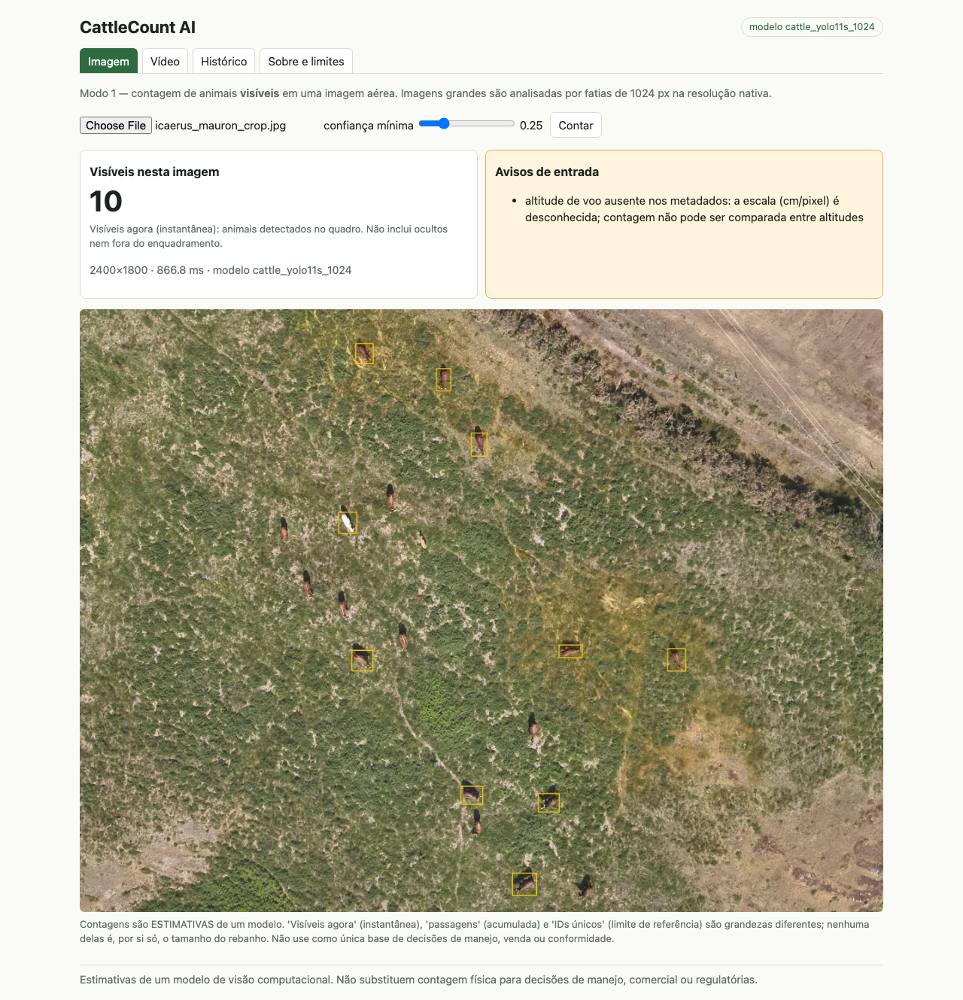
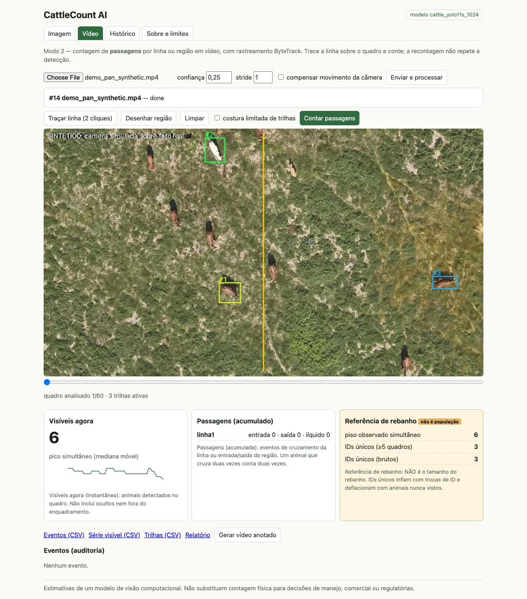
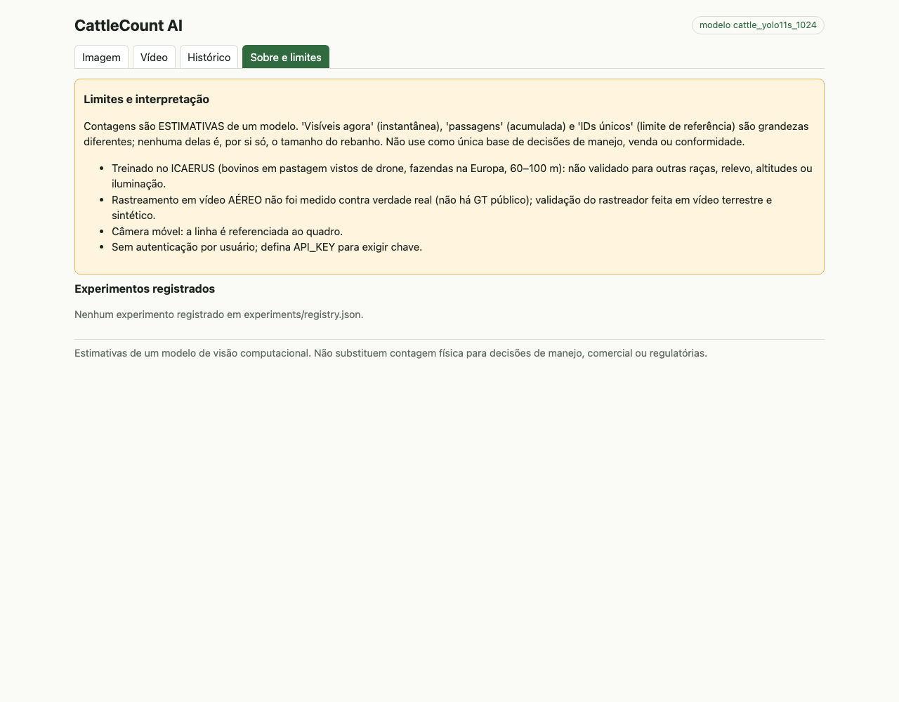
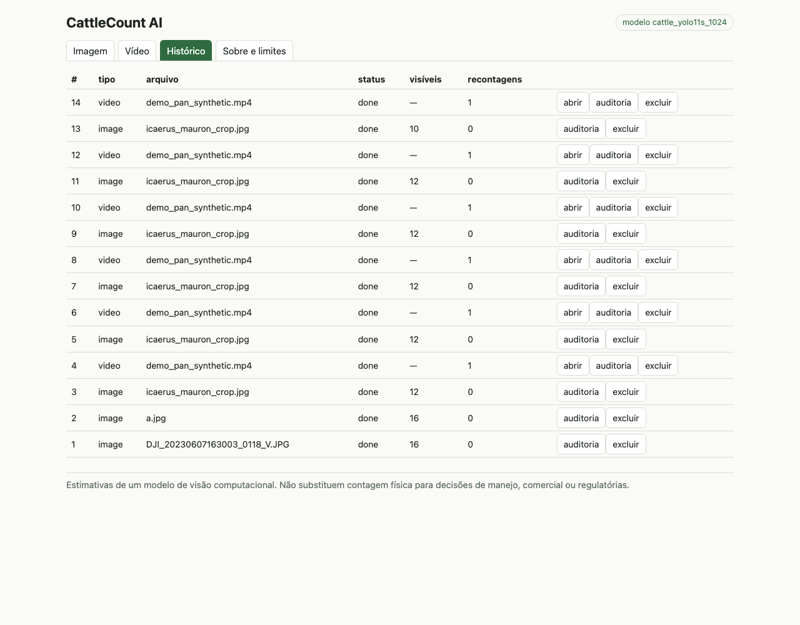

# CattleCount AI

Cattle detection, counting and tracking in aerial images and videos, with an API, a web dashboard and an audit trail.

[Versão em português](README.md) · [Technical guide (Portuguese)](docs/GUIA_TECNICO.md)

> **Notice.** The model was trained and evaluated on ICAERUS (drone imagery, 60–100 m). On an unseen farm it over-counts (+113 % on the test set). Outputs are estimates, not a herd census. See sections 8 and 11 of the [technical guide](docs/GUIA_TECNICO.md).

## Features

- Visible-animal counting in drone images, with sliced inference (1024 px tiles) for large images.
- Video tracking (in-house ByteTrack, optional camera-motion compensation) and line/region passage counting.
- Recounting over persisted tracks without re-running detection; every recount is logged for audit.
- FastAPI backend with PostgreSQL, CSV/JSON/HTML export and a React/TypeScript dashboard.

### Three different counts

| | What it is | What it is not |
|---|---|---|
| Visible now | Animals detected in one frame/image | Excludes occluded and out-of-frame animals |
| Passages | Line crossings / region enter-exit events in video | Not a head count (one animal can cross repeatedly; ID switches distort it) |
| Herd reference | Ranges only: observed simultaneous floor and unique IDs | Never a population; the API has no "population" field |

## Screenshots

| Image | Video and counting |
|---|---|
|  |  |
|  |  |

## Architecture

```
browser --> nginx (frontend + /api proxy) --> FastAPI --> PostgreSQL
                                                |
                                                +- ONNX Runtime (YOLO11s detector, 1024 px, tiles)
                                                +- ByteTrack + counting (cattlecount/)
                                                +- job volume (video, tracks.csv, annotated video)
```

## Quick start

```bash
cp .env.example .env              # set POSTGRES_PASSWORD
docker compose up --build         # or: podman compose up --build
# http://localhost:8080
```

Model weights (`models/onnx/cattle_yolo11s_1024.onnx`, AGPL-3.0) are not committed; see [models/MODEL_CARD.md](models/MODEL_CARD.md). Local (non-container) setup and training reproduction: [technical guide, section 3](docs/GUIA_TECNICO.md#3-instalação-e-execução).

## Repository layout

```
backend/       FastAPI API, SQLAlchemy, ONNX detector
frontend/      React/TypeScript dashboard
cattlecount/   Core: tiling, ByteTrack, counting, metrics
training/      Data, tiles, training and evaluation
scripts/       Benchmark, model registry, results tables
experiments/   Evaluation JSONs and aggregated registry
models/        Model card and registry (weights not versioned)
notebooks/     Data, results and tracking notebooks
sample_data/   Cropped aerial photo and synthetic sample video
infra/         Dockerfiles and nginx
docs/          Technical guide and images
tests/         Unit, API, PostgreSQL, ONNX model and E2E tests
```

## Results

| | Measured |
|---|---|
| Detector, validation farm (Mauron) | mAP50 0.589; count MAE 1.80 animals/image |
| Detector, unseen farm (Jalogny, 92 images, 5 flights) | mAP50 0.102; precision 0.126; 1,724 predicted vs 809 real |
| Adaptation with 2 flights from the target farm (held-out Jalogny flights) | count MAE 11.14 to 1.70; bias +9.7 to −1.1. Cost: worse on the original farm (mAP50 0.589 to 0.368) |
| Off-the-shelf COCO detector | Recall 0.03 |
| ByteTrack on real ground-level video (Mendeley) | IDF1 0.880 (Ultralytics: 0.892; IoU baseline: 0.739) |
| ByteTrack with perfect detections (synthetic) | IDF1 0.999 |
| ByteTrack with the real detector (synthetic) | IDF1 about 0.40; 0 passages vs 3 real |

Caveats: no tracking ground truth exists for real aerial video (the aerial scenario is synthetic); the test set is one farm (5 flights); the dataset subset is 199 images; one model size, one seed. Methodology, confidence intervals and limitations: [technical guide, sections 7 to 11](docs/GUIA_TECNICO.md#7-métricas-e-validação).

## Tests

```bash
.venv/bin/python -m pytest                       # unit, API, PostgreSQL (pgserver), ONNX model
.venv/bin/python -m pytest tests/e2e -m e2e      # browser against the stack at http://localhost:8080
cd frontend && npx vitest run && npx tsc --noEmit
```

## Data and licences

- Code: GPL-3.0 (`LICENSE`).
- Ultralytics code and weights: AGPL-3.0; weights are not committed.
- Data: ICAERUS (Zenodo 10.5281/zenodo.11048412) and Mendeley Data dk54zg67dd, CC BY 4.0. Attribution in [sample_data/ATTRIBUTION.md](sample_data/ATTRIBUTION.md).
- `data/`, `runs/` and all weights (`models/*.pt`, `models/onnx/`) are kept out of Git; `make data` downloads the data (about 2.3 GB).

## Licence

GPL-3.0. See [LICENSE](LICENSE).
