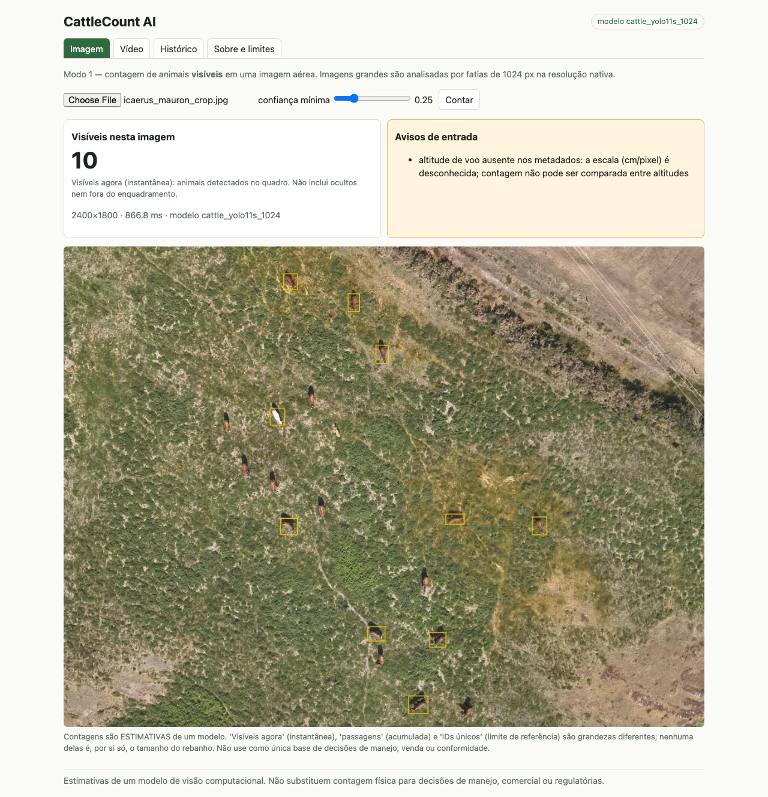
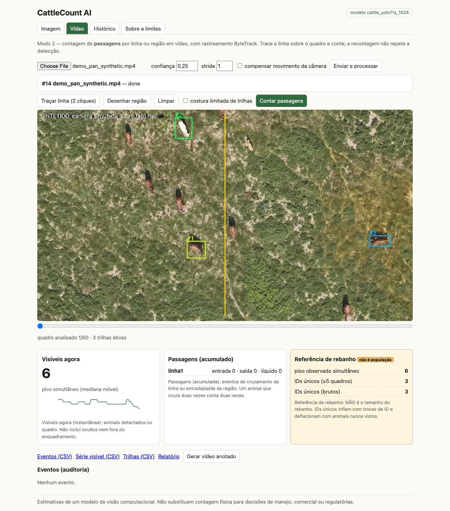
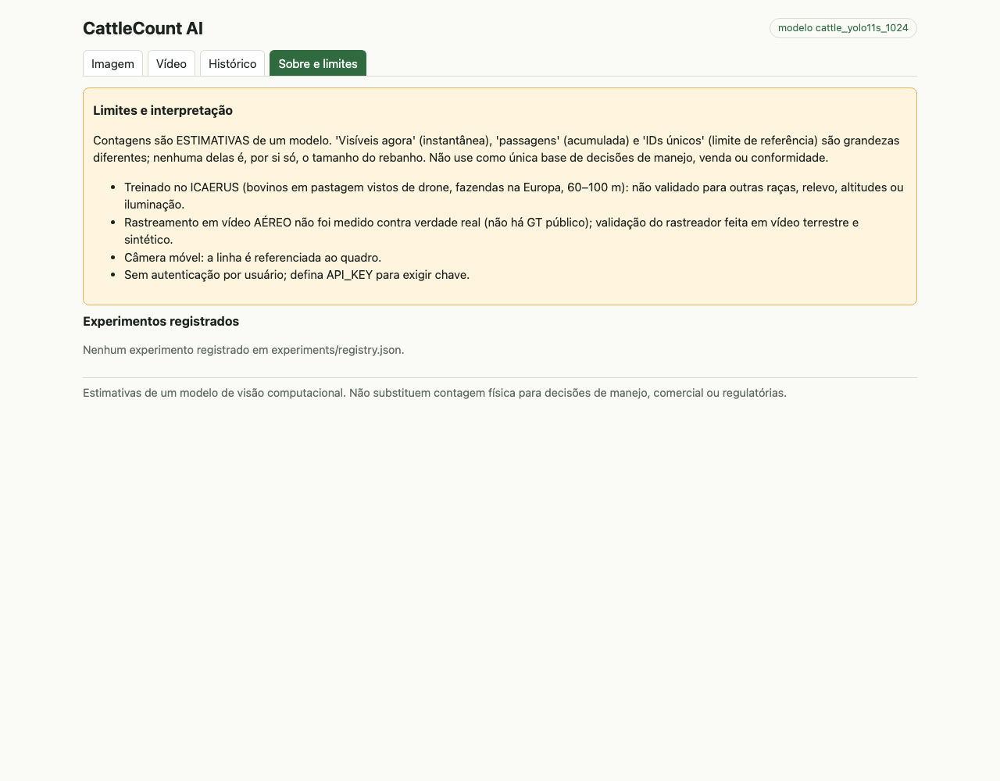
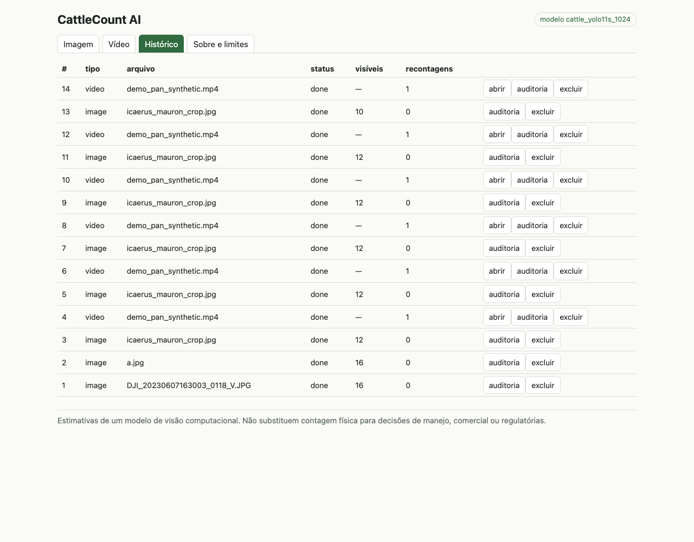

# CattleCount AI

Detecção, contagem e rastreamento de bovinos em imagens aéreas e vídeos, com API, painel web e trilha de auditoria.

[English version](README.en.md) · [Guia técnico](docs/GUIA_TECNICO.md)

> **Aviso.** O modelo foi treinado e avaliado no dataset ICAERUS (drones, 60–100 m). Em fazenda inédita ele superconta (+113 % no teste). Os números são estimativas e não constituem censo do rebanho. Detalhes na seção 8 e 11 do [guia técnico](docs/GUIA_TECNICO.md).

## Funcionalidades

- Contagem de animais visíveis em imagens de drone, com inferência fatiada (tiles de 1024 px) para imagens grandes.
- Rastreamento em vídeo (ByteTrack próprio, com compensação opcional de movimento de câmera) e contagem de passagens por linha ou região.
- Recontagem sobre trilhas persistidas, sem nova detecção; cada recontagem é registrada para auditoria.
- API FastAPI com PostgreSQL, exportação em CSV/JSON/HTML e painel web em React/TypeScript.

### Três contagens distintas

| | O que é | O que não é |
|---|---|---|
| Visíveis agora | Animais detectados num quadro/imagem | Não inclui ocultos nem fora do quadro |
| Passagens | Cruzamentos de linha / entradas e saídas de região, em vídeo | Não é número de animais (o mesmo animal pode cruzar várias vezes; troca de ID distorce) |
| Referência de rebanho | Apenas faixas: piso observado e IDs únicos | Nunca é população; a API não tem campo "população" |

## Screenshots

| Imagem | Vídeo e contagem |
|---|---|
|  |  |
|  |  |

## Arquitetura

```
navegador --> nginx (frontend + proxy /api) --> FastAPI --> PostgreSQL
                                                  |
                                                  +- ONNX Runtime (detector YOLO11s, 1024 px, fatias)
                                                  +- ByteTrack + contagem (cattlecount/)
                                                  +- volume de jobs (vídeo, tracks.csv, vídeo anotado)
```

## Início rápido

```bash
cp .env.example .env              # defina POSTGRES_PASSWORD
docker compose up --build         # ou: podman compose up --build
# http://localhost:8080
```

Os pesos ONNX (`models/onnx/cattle_yolo11s_1024.onnx`, AGPL-3.0) não são versionados; ver [models/MODEL_CARD.md](models/MODEL_CARD.md). Execução local sem contêiner e reprodução do treino: [guia técnico, seção 3](docs/GUIA_TECNICO.md#3-instalação-e-execução).

## Estrutura do repositório

```
backend/       API FastAPI, SQLAlchemy, detector ONNX
frontend/      Painel React/TypeScript
cattlecount/   Núcleo: tiling, ByteTrack, contagem, métricas
training/      Dados, tiles, treino e avaliação
scripts/       Benchmark, registro de modelos, tabelas de resultados
experiments/   JSONs de avaliação e registro agregado
models/        Model card e registro (pesos não versionados)
notebooks/     Notebooks de dados, resultados e rastreamento
sample_data/   Foto aérea recortada e vídeo sintético de exemplo
infra/         Dockerfiles e nginx
docs/          Guia técnico e imagens
tests/         Testes de unidade, API, PostgreSQL, modelo ONNX e E2E
```

## Resultados

| | Resultado |
|---|---|
| Detector, fazenda de validação (Mauron) | mAP50 0,589; MAE de contagem 1,80 animais/imagem |
| Detector, fazenda inédita (Jalogny, 92 imagens, 5 voos) | mAP50 0,102; precisão 0,126; 1 724 previstos para 809 reais |
| Adaptação com 2 voos da própria fazenda (voos retidos de Jalogny) | MAE 11,14 para 1,70; viés +9,7 para −1,1. Custo: piora na fazenda original (mAP50 0,589 para 0,368) |
| Detector COCO sem ajuste | Revocação 0,03 |
| ByteTrack em vídeo terrestre real (Mendeley) | IDF1 0,880 (Ultralytics: 0,892; baseline IoU: 0,739) |
| ByteTrack com detecções perfeitas (sintético) | IDF1 0,999 |
| ByteTrack com detector real (sintético) | IDF1 aprox. 0,40; 0 passagens contra 3 reais |

Metodologia, intervalos de confiança e limitações: [guia técnico, seções 7 a 11](docs/GUIA_TECNICO.md#7-métricas-e-validação).

## Testes

```bash
.venv/bin/python -m pytest                       # unidade, API, PostgreSQL (pgserver), modelo ONNX
.venv/bin/python -m pytest tests/e2e -m e2e      # navegador contra a pilha em http://localhost:8080
cd frontend && npx vitest run && npx tsc --noEmit
```

## Dados e licenças

- Código: GPL-3.0 (`LICENSE`).
- Pesos e código Ultralytics: AGPL-3.0; os pesos não são versionados.
- Dados: ICAERUS (Zenodo 10.5281/zenodo.11048412) e Mendeley Data dk54zg67dd, CC BY 4.0. Atribuição em [sample_data/ATTRIBUTION.md](sample_data/ATTRIBUTION.md).
- `data/`, `runs/` e todos os pesos (`models/*.pt`, `models/onnx/`) ficam fora do Git; `make data` baixa os dados (cerca de 2,3 GB).

## Licença

GPL-3.0. Ver [LICENSE](LICENSE).
